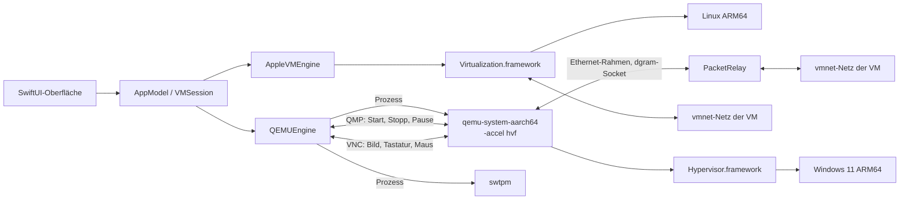

# Architektur von Pluralism

Stand: Version 0.2 (Oktober 2026), Zielsystem macOS 27. Grundlage ist die Recherche in [research/](research/).

## Grundprinzip: Isolation

Jede VM ist vom Mac abgeschottet. Pluralism richtet bewusst **keine** Verbindung zwischen Mac und Gast ein,
außer Netzwerk und Peripherie.

| Bereich | In Pluralism | Bewusst weggelassen |
|---|---|---|
| Netzwerk | Eigenes vmnet-Netz pro VM (Internet und Mac, nur Mac, kein Netz), Ausweich-Netz bei Fehlern | Bridged-Netz, Netz zwischen VMs |
| Peripherie | Bildschirm, Tastatur, Maus/Trackpad, Ton, optional Mikrofon, Installations-ISOs als USB-Laufwerk | |
| Kanäle Mac ↔ Gast | keine | Zwischenablage (SPICE-Agent, vdagent, VNC-Zwischenablage), geteilte Ordner (virtiofs, 9p), vsock, virtio-serial, Gastagenten, Drag-and-drop |
| Remote Desktop (optional, Windows) | Weiterleitung von 3389 auf 127.0.0.1, Verbindungsdatei ohne Umleitungen | Zwischenablage, Laufwerke, Drucker, Kamera, USB über RDP |

Die Tests prüfen das: Die QEMU-Kommandozeile enthält weder virtio-serial noch vdagent noch 9p, die
Windows-Antwortdatei installiert keine Agenten, und ältere Konfigurationen mit Freigaben werden beim
Einlesen ignoriert.

## Zwei Engines

Apple stellt auf Apple Silicon zwei Wege zur Virtualisierung bereit:

| | Virtualization.framework (VZ) | Hypervisor.framework (HVF) |
|---|---|---|
| Ebene | Fertiger VM-Baukasten mit Geräten (virtio) | Rohe CPU-Virtualisierung: vCPU-Threads, Speicher, Interrupt-Controller |
| Geräte | Von Apple: virtio-blk, virtio-net, virtio-gpu (2D), Ton, USB-Speicher | Muss die App selbst emulieren |
| Linux | Sehr gut, offiziell | Möglich, viel Eigenarbeit |
| Windows 11 ARM | Nur mit privaten APIs, kein TPM, kein Secure Boot vor macOS 27, feste Auflösung | Geht, so machen es Parallels und VMware mit eigenen VMMs |

Pluralism nutzt deshalb:

- **Linux ARM64 → Virtualization.framework** (`AppleVMEngine`)
- **Windows 11 ARM64 → QEMU mit `-accel hvf`** als eigener Prozess (`QEMUEngine`). QEMU liegt in der App
  unter `Contents/Resources/Runtime` (siehe „Mitgelieferte Laufzeit“).

Ein eigener VMM direkt auf Hypervisor.framework (wie bei Parallels) ist das Langzeitziel, siehe [ROADMAP.md](ROADMAP.md).



QMP und VNC laufen über Unix-Sockets zwischen Pluralism und dem QEMU-Prozess auf dem Mac. Sie steuern die
virtuelle Hardware und transportieren Bild und Eingaben, haben aber keinen Zugang zum Dateisystem oder zur
Zwischenablage des Gasts.

## Module

### PluralismCore (plattformneutral, getestet)

Nur Foundation, kompiliert auch unter Linux.

| Datei | Aufgabe |
|---|---|
| `Model/VMConfiguration.swift` | VM-Konfiguration, tolerant gegenüber alten `config.json`-Dateien, Validierung mit verständlichen Meldungen |
| `Model/VMBundle.swift` | Aufbau eines VM-Ordners, kurze Socket-Pfade (`RuntimePaths`), Snapshot-Metadaten |
| `Host/HostProfile.swift` | Beschreibung des Macs und `ResourceAdvisor` mit Empfehlungen (P-Kerne, Speicherreserve für macOS) |
| `QEMU/QEMUCommandBuilder.swift` | Erzeugt die QEMU- und swtpm-Kommandozeilen |
| `QEMU/QEMUToolchain.swift` | Werkzeuge, Firmware, Geräteerkennung (`-device help`) |
| `QEMU/QMPProtocol.swift` | QMP-Befehle und -Nachrichten |
| `RFB/RFBProtocol.swift` | VNC-Client (RFB 3.8, Raw, CopyRect, DesktopSize, QEMU-Tastenerweiterung), ohne Zwischenablage |
| `RFB/KeyboardMapping.swift` | Mac-Keycodes zu PC-Scancodes, inklusive ISO-Tausch für deutsche Tastaturen |
| `Windows/UnattendBuilder.swift` | `autounattend.xml` und `pluralism-setup.cmd` für die automatische Windows-Installation |
| `Network/DHCPProbe.swift` | DHCP-Discover als Ethernet-Rahmen bauen und Antworten auswerten (für `pluralism-netcheck`) |
| `Network/FixedSubnet.swift` | Feste Adressbereiche: Platz 0 bis 39, „Internet und Mac“ 192.168.160+x, „Nur Mac“ 192.168.200+x |
| `Network/GuestAddressWatcher.swift` | Erkennt die tatsächliche IPv4-Adresse des Gasts an seinen eigenen Rahmen (IPv4, ARP) |

### PluralismNet (macOS, vmnet)

| Datei | Aufgabe |
|---|---|
| `VMNetwork.swift` | Ein vmnet-Netz: Modus, fester Bereich /24 (oder von vmnet gewählt), DHCP-Reservierung der .2 für die MAC des Gasts |
| `VMNetworkRegistry.swift` | Hält die Netze, solange Pluralism läuft, damit eine VM beim Neustart dasselbe Netz bekommt; Ausweichbereich, wenn der feste belegt ist |
| `PacketRelay.swift` | Paketbrücke QEMU ↔ vmnet: Unix-Datagramm-Socket auf der einen Seite, `vmnet_read`/`vmnet_write` gebündelt auf der anderen; meldet die Adresse, die der Gast benutzt |

`pluralism-netcheck` nutzt das ohne VM: Netz anlegen, Brücke starten, als „Gast“ ein DHCP-Discover senden,
Adresse prüfen. Die CI führt das bei jedem Push auf einem macOS-27-Runner ohne Root aus.

#### vmnet auf macOS 27: was die Prüfung ergeben hat

| Frage | Ergebnis |
|---|---|
| Root nötig? | Nein. Nötig ist das Entitlement `com.apple.security.virtualization` (ohne: Code 1002 beim Anlegen). Die App hat es. |
| Eigener Bereich | Geht, wenn die Adresse des Macs (.1) übergeben wird. Mit der Netzadresse (.0) startet die Schnittstelle nicht (Code 1001). |
| Ohne eigenen Bereich | vmnet vergibt 192.168.64.0/24, dann .65, .66 … („Nur Mac“ ab 192.168.128.0/24), bei jedem neuen Netz den nächsten. |
| DHCP-Reservierung | Funktioniert innerhalb des Bereichs. Außerhalb wird sie still ignoriert. |
| Bereich wieder frei? | Erst wenn der Prozess endet. Im selben Prozess scheitert ein zweites Netz mit demselben Bereich (Code 1001). Daher `VMNetworkRegistry`. |
| Mehrere Netze gleichzeitig | Ja, jedes mit eigenem Bereich. |

### Pluralism (macOS-App)

| Bereich | Dateien | Aufgabe |
|---|---|---|
| App | `PluralismApp`, `AppModel`, `VMSession` | Fenster, Bibliothek, eine Sitzung pro VM, Beenden ohne verwaiste Prozesse |
| Apple-Engine | `AppleVMEngine`, `AppleConfigurationFactory` | VZ-Konfiguration, Start, Pause, Zustand sichern, ISO im Betrieb einlegen |
| QEMU-Engine | `QEMUEngine`, `ManagedProcess`, `QMPClient`, `RFBConnection`, `RFBDisplayView`, `UnixSocket` | Prozesse, Steuerung, Bild und Eingaben |
| Werkzeuge | `HostInspector`, `ToolchainDetector` | sysctl-Daten, Suche nach QEMU, swtpm und Firmware |
| Medien | `DiskImageService`, `GuestMediaBuilder`, `DownloadService` | Platten (RAW, ASIF, qcow2), Setup-ISO per `hdiutil` mit `$WinPEDriver$`, virtio-win-Download |
| Snapshots | `SnapshotService` | APFS-Klone von Platte, UEFI, TPM, Konfiguration |
| Oberfläche | `UI/*` | Liste, Details, Assistent, Einstellungen, VM-Fenster, App-Einstellungen |

## VM-Ordner

```
~/Library/Application Support/Pluralism/VMs/<UUID>.pluralismvm/
├── config.json               Konfiguration (ohne Passwörter)
├── disk.img | disk.asif | disk.qcow2
├── efi-variables.bin         UEFI-Variablen (Apple-Engine)
├── machine-identifier.bin    Maschinenkennung (Apple-Engine)
├── qemu-efi-vars.fd          UEFI-Variablen (QEMU, beschreibbare Kopie der Vorlage)
├── saved-state.vzvmsave      gesicherter Zustand nach "Anhalten" (Apple-Engine)
├── tpm/                      Zustand des emulierten TPM
├── unattend.iso              Antwortdatei, Einrichtungsskript, ARM64-Treiber (Windows)
├── virtio-helper.img         nur während der Umstellung NVMe → virtio (Windows)
├── logs/                     engine.log (QEMU), swtpm.log, serial.log
└── snapshots/<UUID>/         APFS-Klone plus snapshot.json
```

Unix-Sockets liegen unter `/tmp/pluralism-<uid>/<kurz-ID>/` (Rechte 0700), weil macOS Socket-Pfade auf
104 Bytes begrenzt.

## Linux-Gast im Detail

- `VZEFIBootLoader` mit eigenem Variablenspeicher, `VZGenericPlatformConfiguration` mit gespeicherter Kennung
- Systemplatte als virtio-blk, ISO als USB-Massenspeicher
- `VZVmnetNetworkDeviceAttachment` mit eigenem vmnet-Netz (fester Bereich, Gast .2, Mac .1);
  Ausweichweg `VZNATNetworkDeviceAttachment`
- `VZVirtioGraphicsDeviceConfiguration` mit `automaticallyReconfiguresDisplay`
- USB-Tastatur, USB-Zeigegerät mit absoluten Koordinaten
- virtio-sound (Ausgabe, optional Mikrofon), Entropie, Speicher-Ballon
- Systemplatte standardmäßig im ASIF-Format (Apples Sparse-Format seit macOS 26)
- XHCI-Controller für ISOs im laufenden Betrieb
- verschachtelte Virtualisierung (M3 oder neuer): auf dem M4 Pro verfügbar
- serielle Konsole optional in `logs/serial.log`
- nicht vorhanden: SPICE-Agent-Port, virtiofs, vsock

## Windows-Gast im Detail

QEMU-Aufruf (gekürzt), abgeleitet von bewährten Konfigurationen für Windows 11 ARM64:

```
qemu-system-aarch64 -nodefaults -machine virt,gic-version=3 -accel hvf -cpu host
  -smp cpus=6,sockets=1,cores=6,threads=1 -m 12288M
  -drive if=pflash,unit=0,file=edk2-aarch64-code.fd,readonly=on
  -drive if=pflash,unit=1,file=<vm>/qemu-efi-vars.fd
  -device ramfb -device qemu-xhci,id=xhci -device usb-kbd -device usb-tablet
  -object iothread,id=iothread0
  -drive if=none,id=system,format=raw,file=<vm>/disk.img,aio=threads,cache=writeback,discard=unmap
  -device virtio-blk-pci,drive=system,iothread=iothread0,num-queues=6,bootindex=1
  -device usb-storage,drive=installer,bootindex=0   (Windows-ISO)
  -device usb-storage,drive=drivers                 (virtio-win)
  -device usb-storage,drive=unattend                (Antwortdatei)
  -netdev dgram,id=net0,local.type=unix,local.path=net-q.sock,remote.type=unix,remote.path=net-h.sock
  -device virtio-net-pci,netdev=net0,mac=…
  -audiodev coreaudio -device intel-hda -device hda-output
  -qmp unix:qmp.sock -display none -vnc unix:vnc.sock
```

Warum so:

- **virtio-blk mit eigenem I/O-Thread** ist deutlich schneller als die emulierte NVMe-Platte: Plattenzugriffe
  laufen parallel zu den vCPUs, mit mehreren Warteschlangen. Das **Rohformat** spart die Verwaltungsarbeit von
  qcow2; Snapshots laufen ohnehin über APFS-Klone.
- Den Treiber **viostor** bekommt Windows schon während der Installation: Setup lädt automatisch alle Treiber aus
  einem Ordner `$WinPEDriver$` im Wurzelverzeichnis eines Laufwerks. Pluralism legt dort viostor, vioscsi,
  NetKVM, vioinput, Balloon und viorng ab. Ohne virtio-win-ISO oder bei manueller Installation bleibt die
  Systemplatte auf **NVMe**, die Windows ohne Treiber kennt.
- **Umstellung älterer VMs** (NVMe → virtio) in zwei Schritten: Erst startet Windows mit einer kleinen
  virtio-Hilfsplatte und bindet den Treiber ein. Nach mindestens zwei Minuten Laufzeit legt Pluralism beim
  nächsten Start einen Snapshot an und schaltet die Systemplatte um.
- **USB-Massenspeicher** für die ISOs kennt Windows ohne Zusatztreiber.
- **ramfb** ist ein einfacher Framebuffer, den Windows ohne Treiber anzeigt (feste Auflösung).
  Nach Installation des Treibers `viogpudo` kann man auf virtio-gpu umstellen.
- **virtio-net** braucht den Treiber NetKVM. Pluralism kopiert ihn beim Anlegen aus dem virtio-win-ISO
  in das Setup-Medium, das Einrichtungsskript installiert ihn nach der ersten Anmeldung per `pnputil`.
  Übernommen werden nur Treiber für Netzwerk, Speicher und Peripherie
  (NetKVM, viostor, vioscsi, Balloon, viorng, vioinput, viogpudo), keine Kanal-Treiber wie vioserial oder viofs.
- **TPM:** Das normale QEMU bietet unter ARM nur `tpm-tis-device`, das Windows ARM auf Apple Silicon laut
  Berichten nicht zuverlässig nutzt („Code 10“). Mit dem Gerät `tpm-crb-device` (ein Patch für QEMU) klappt es.
  Pluralism erkennt, welches Gerät vorhanden ist. Standard ist „kein TPM“ plus Umgehung der Prüfung.
- **Netzwerk über vmnet:** QEMU schickt jeden Ethernet-Rahmen als Datagramm an Pluralism (`-netdev dgram`),
  Pluralism reicht ihn gebündelt an ein eigenes vmnet-Netz weiter (`PacketRelay`). Die neue vmnet-Schnittstelle
  aus macOS 26 (`vmnet_network_create`, `vmnet_interface_start_with_network`) braucht dafür weder Root noch das
  Entitlement `com.apple.vm.networking`, wohl aber `com.apple.security.virtualization`. Windows bekommt per
  DHCP-Reservierung immer dieselbe Adresse (z. B. 192.168.160.2) und ist vom Mac direkt erreichbar.
- **Ausweich-Netz:** Schlägt vmnet fehl, nutzt QEMU sein Usermode-Netz (slirp). Der Mac erreicht Windows dann
  nur über ausdrücklich eingerichtete Portweiterleitungen auf 127.0.0.1.

### Anzeige und Eingabe

QEMU stellt das Bild über einen VNC-Server auf einem Unix-Socket bereit. `RFBConnection` liest es in einen
eigenen Puffer (32 Bit, BGRX), `RFBDisplayView` zeigt es seitenverhältnistreu an.

- Tastatur über die QEMU-Erweiterung „Extended Key Event“: Pluralism schickt PC-Scancodes, das
  Tastaturlayout im Gast entscheidet über das Zeichen. ISO-Tastaturen (deutsch) werden erkannt.
- Mac-Kürzel: Cmd+Buchstabe wird im Gast zu Strg+Buchstabe, Cmd allein ist die Windows-Taste,
  Cmd+Q/W/H/M/Tab bleiben beim Mac. Dabei wird nur die Tastatur übersetzt, Inhalte wandern nicht zwischen Mac und Gast.
- Maus als absolute Koordinaten (USB-Tablet), Scrollen mit Trackpad-Glättung.
- Zwischenablage-Nachrichten des VNC-Servers werden verworfen, der Client sendet keine.

### Automatische Installation

`autounattend.xml` (Pässe windowsPE, specialize, oobeSystem, alles für `arm64`):

1. LabConfig-Schlüssel umgehen TPM-, Secure-Boot-, RAM- und CPU-Prüfung
2. Platte 0 wird partitioniert (EFI 300 MB, MSR 16 MB, Rest NTFS)
3. Edition per Schlüssel (Standard: öffentlicher KMS-Client-Schlüssel für Pro, aktiviert nicht)
4. Lokales Konto, Online-Konto-Seiten ausgeblendet, `BypassNRO` gesetzt, einmal automatisch anmelden
5. Erste Anmeldung: `pluralism-setup.cmd` sucht sein Medium auf D: bis Z:, installiert die Treiber per
   `pnputil`, schaltet Remote Desktop nur ein, wenn die Weiterleitung konfiguriert ist, und deaktiviert
   den Ruhezustand

Die Sprache des ISOs liest Pluralism aus `sources/lang.ini`, damit die Antwortdatei dazu passt.
Das Passwort steht nur im Setup-ISO, nicht in `config.json`.

## Mitgelieferte Laufzeit

`scripts/runtime/build-runtime.sh` (in der CI auf einem macOS-27-Runner, mit Cache):

1. QEMU-Quellcode laden, Prüfsumme gegen `scripts/runtime/versions.env` prüfen
2. Konfigurieren mit `--without-default-features` und nur dem Nötigen: `aarch64-softmmu`, HVF, Werkzeuge
   (qemu-img), VNC, Cocoa, CoreAudio, slirp, TPM, Device-Tree. Keine Gastagenten, keine Ordnerfreigaben.
3. swtpm aus Homebrew übernehmen
4. `assemble.py`: Programme nach `bin/`, Firmware nach `share/qemu/`, alle Bibliotheken außerhalb des Systems
   nach `lib/`; Ladepfade auf `@executable_path/../lib` bzw. `@loader_path` umschreiben; ad hoc signieren;
   Lizenztexte und `pluralism-runtime.json` ablegen; prüfen, dass nichts mehr auf Homebrew verweist
5. Selbsttest: Versionen, benötigte Geräte, `-netdev dgram`, `-accel hvf`

`build-app.sh` kopiert die Laufzeit nach `Contents/Resources/Runtime` und signiert QEMU mit
`Resources/QEMU.entitlements`. `ToolchainDetector` findet sie dort zuerst.

## Signatur und Rechte

`scripts/build-app.sh` signiert ad hoc (`codesign -s -`) mit:

- `com.apple.security.virtualization` (VZ und vmnet ohne Root, funktioniert ad hoc)
- `com.apple.security.hypervisor` (für den späteren eigenen VMM; das mitgelieferte QEMU trägt es selbst)
- `com.apple.security.device.audio-input` (Mikrofon, nur wenn in der VM eingeschaltet)

Nicht möglich ohne Apples Freigabe: `com.apple.vm.networking` (Bridged-Netz) und
`com.apple.vm.device-access` (USB-Zugriff aus QEMU). Die App läuft ohne Sandbox.

## Tests

`swift test` prüft den Kern: Konfiguration und Validierung, Empfehlungen für den M4 Pro, QEMU-Argumente
(inklusive Isolation, TPM, Secure Boot, Escaping), QMP, das RFB-Protokoll mit einem simulierten Server,
Framebuffer-Operationen, Tastaturtabellen und die Windows-Antwortdatei. GitHub Actions baut bei jedem Push
den Kern unter Linux und die komplette App auf einem Apple-Silicon-Runner.
