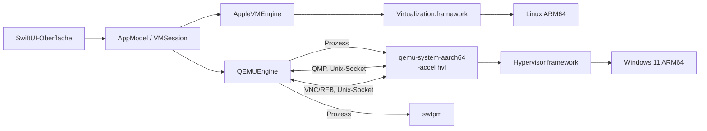

# Architektur von Pluralism

Stand: Version 0.1 (Oktober 2026). Grundlage ist die Recherche in [research/](research/).

## Grundentscheidung: zwei Engines

Apple stellt auf Apple Silicon zwei Wege zur Virtualisierung bereit:

| | Virtualization.framework (VZ) | Hypervisor.framework (HVF) |
|---|---|---|
| Ebene | Fertiger VM-Baukasten mit Geräten (virtio) | Rohe CPU-Virtualisierung: vCPU-Threads, Speicher, Interrupt-Controller |
| Geräte | Von Apple: virtio-blk, virtio-net, virtio-gpu (2D), virtiofs, Ton, SPICE-Zwischenablage, USB-Speicher | Muss die App selbst emulieren |
| Linux | Sehr gut, offiziell | Möglich, viel Eigenarbeit |
| Windows 11 ARM | Nur mit privaten APIs, kein TPM, kein Secure Boot vor macOS 27, feste Auflösung | Geht, so machen es Parallels (eigener VMM), VMware und UTM (QEMU) |

Pluralism nutzt deshalb:

- **Linux ARM64 → Virtualization.framework** (`AppleVMEngine`)
- **Windows 11 ARM64 → QEMU mit `-accel hvf`** als eigener Prozess (`QEMUEngine`)

Parallels geht für Windows denselben Weg wie QEMU, nur mit einem eigenen, stark optimierten VMM statt QEMU.
Ein eigener VMM ist das Langzeitziel (siehe [ROADMAP.md](ROADMAP.md)).



## Module

### PluralismCore (plattformneutral, getestet)

Nur Foundation, kompiliert auch unter Linux. Enthält alles, was sich ohne Apple-UI testen lässt.

| Datei | Aufgabe |
|---|---|
| `Model/VMConfiguration.swift` | Komplette VM-Konfiguration, tolerant gegenüber alten `config.json`-Dateien, Validierung mit verständlichen Meldungen |
| `Model/VMBundle.swift` | Aufbau eines VM-Ordners, kurze Socket-Pfade (`RuntimePaths`), Snapshot-Metadaten |
| `Host/HostProfile.swift` | Beschreibung des Macs und `ResourceAdvisor` mit Empfehlungen (P-Kerne, Speicherreserve für macOS) |
| `QEMU/QEMUCommandBuilder.swift` | Erzeugt die QEMU- und swtpm-Kommandozeilen |
| `QEMU/QEMUToolchain.swift` | Werkzeuge, Firmware, Geräteerkennung (`-device help`) |
| `QEMU/QMPProtocol.swift` | QMP-Befehle und -Nachrichten |
| `RFB/RFBProtocol.swift` | VNC-Client-Protokoll (RFB 3.8, Raw, CopyRect, DesktopSize, QEMU-Tastenerweiterung) |
| `RFB/KeyboardMapping.swift` | Mac-Keycodes zu PC-Scancodes, inklusive ISO-Tausch für deutsche Tastaturen |
| `Windows/UnattendBuilder.swift` | `autounattend.xml` und `pluralism-setup.cmd` für die automatische Windows-Installation |
| `Linux/LinuxGuestTools.swift` | Installationsskript der Pluralism Tools für Linux |

### Pluralism (macOS-App)

| Bereich | Dateien | Aufgabe |
|---|---|---|
| App | `PluralismApp`, `AppModel`, `VMSession` | Fenster, Bibliothek, eine Sitzung pro VM, Beenden ohne verwaiste Prozesse |
| Apple-Engine | `AppleVMEngine`, `AppleConfigurationFactory` | VZ-Konfiguration, Start, Pause, Zustand sichern, ISO im Betrieb anhängen |
| QEMU-Engine | `QEMUEngine`, `ManagedProcess`, `QMPClient`, `RFBConnection`, `RFBDisplayView`, `UnixSocket` | Prozesse, Steuerung, Bild und Eingaben |
| Werkzeuge | `HostInspector`, `ToolchainDetector` | sysctl-Daten, Suche nach QEMU/swtpm/Firmware |
| Medien | `DiskImageService`, `GuestMediaBuilder`, `DownloadService` | Platten (RAW, ASIF, qcow2), ISOs per `hdiutil`, Downloads |
| Snapshots | `SnapshotService` | APFS-Klone von Platte, UEFI, TPM, Konfiguration |
| Oberfläche | `UI/*` | Liste, Details, Assistent, Einstellungen, VM-Fenster, App-Einstellungen |

## VM-Ordner

```
~/Library/Application Support/Pluralism/VMs/<UUID>.pluralismvm/
├── config.json               Konfiguration (ohne Passwörter)
├── disk.img | disk.asif | disk.qcow2
├── efi-variables.bin         UEFI-Variablen (Apple-Engine)
├── machine-identifier.bin    Maschinenkennung (Apple-Engine)
├── qemu-efi-vars.fd          UEFI-Variablen (QEMU, beschreibbare Kopie der Vorlage)
├── saved-state.vzvmsave      gesicherter Zustand nach "Anhalten" (Apple-Engine)
├── tpm/                      Zustand des emulierten TPM
├── unattend.iso              Antwortdatei, Einrichtungsskript, ARM64-Treiber (Windows)
├── pluralism-tools.iso       Pluralism Tools (Linux)
├── logs/                     engine.log (QEMU), swtpm.log, serial.log
└── snapshots/<UUID>/         APFS-Klone plus snapshot.json
```

Unix-Sockets liegen unter `/tmp/pluralism-<uid>/<kurz-ID>/`, weil macOS Socket-Pfade auf 104 Bytes begrenzt.

## Linux-Gast im Detail

Geräte (Apples Beispiel „Running GUI Linux in a virtual machine on a Mac“ plus Integration):

- `VZEFIBootLoader` mit eigenem Variablenspeicher, `VZGenericPlatformConfiguration` mit gespeicherter Kennung
- Systemplatte als virtio-blk, ISO und Tools als USB-Massenspeicher
- `VZNATNetworkDeviceAttachment` (Netz 192.168.64.0/24, Gast vom Mac direkt erreichbar)
- `VZVirtioGraphicsDeviceConfiguration` mit `automaticallyReconfiguresDisplay`
- virtiofs mit Tag `pluralism`, alle freigegebenen Ordner als Unterordner (`VZMultipleDirectoryShare`)
- SPICE-Agent-Port für die Zwischenablage (`spice-vdagent` im Gast)
- virtio-sound, Entropie, Speicher-Ballon, vsock (für einen späteren Gastagenten)
- XHCI-Controller (macOS 15) für Medien im laufenden Betrieb
- verschachtelte Virtualisierung (M3 oder neuer, macOS 15): auf dem M4 Pro verfügbar

## Windows-Gast im Detail

QEMU-Aufruf (gekürzt), abgeleitet von UTMs Konfiguration für Windows 11 ARM64:

```
qemu-system-aarch64 -nodefaults -machine virt,gic-version=3 -accel hvf -cpu host
  -smp cpus=6,sockets=1,cores=6,threads=1 -m 12288M
  -drive if=pflash,unit=0,file=edk2-aarch64-code.fd,readonly=on
  -drive if=pflash,unit=1,file=<vm>/qemu-efi-vars.fd
  -device ramfb -device qemu-xhci,id=xhci -device usb-kbd -device usb-tablet
  -drive if=none,id=system,format=qcow2,file=<vm>/disk.qcow2 -device nvme,drive=system,bootindex=1
  -device usb-storage,drive=installer,bootindex=0   (Windows-ISO)
  -device usb-storage,drive=drivers                 (virtio-win)
  -device usb-storage,drive=unattend                (Antwortdatei)
  -netdev user,id=net0,hostfwd=tcp:127.0.0.1:33389-:3389 -device virtio-net-pci,netdev=net0
  -chardev qemu-vdagent,clipboard=on + virtserialport com.redhat.spice.0
  -audiodev coreaudio -device intel-hda -device hda-output
  -qmp unix:qmp.sock -display none -vnc unix:vnc.sock
```

Warum so:

- **NVMe** und **USB-Massenspeicher** kennt Windows ohne Zusatztreiber, die Installation läuft also sofort.
- **ramfb** ist ein einfacher Framebuffer, den Windows ohne Treiber anzeigt (feste Auflösung).
  Nach Installation des Treibers `viogpudo` kann man auf virtio-gpu umstellen.
- **virtio-net** braucht den Treiber NetKVM. Pluralism kopiert ihn beim Anlegen aus dem virtio-win-ISO
  in das Antwort-Medium, das Einrichtungsskript installiert ihn nach der ersten Anmeldung per `pnputil`.
- **TPM:** Das normale QEMU bietet unter ARM nur `tpm-tis-device`, das Windows ARM auf Apple Silicon laut
  Berichten nicht zuverlässig nutzt („Code 10“). UTMs QEMU-Fork bringt `tpm-crb-device`, das funktioniert.
  Pluralism erkennt, welches Gerät vorhanden ist. Standard ist „kein TPM“ plus Umgehung der Prüfung.
- **Usermode-Netz** (slirp) braucht weder Root noch Sonderrechte. Der Mac erreicht Windows über
  Portweiterleitungen, Windows erreicht den Mac unter 10.0.2.2.

### Anzeige und Eingabe

QEMU stellt das Bild über einen VNC-Server auf einem Unix-Socket bereit. `RFBConnection` liest es in einen
eigenen Puffer (32 Bit, BGRX), `RFBDisplayView` zeigt es seitenverhältnistreu an.

- Tastatur über die QEMU-Erweiterung „Extended Key Event“: Pluralism schickt PC-Scancodes, das
  Tastaturlayout im Gast entscheidet über das Zeichen. ISO-Tastaturen (deutsch) werden erkannt.
- Mac-Kürzel: Cmd+Buchstabe wird zu Strg+Buchstabe, Cmd allein ist die Windows-Taste,
  Cmd+Q/W/H/M/Tab bleiben beim Mac.
- Maus als absolute Koordinaten (USB-Tablet), Scrollen mit Trackpad-Glättung.
- Zwischenablage: Text vom Mac zum Gast über RFB-ClientCutText und den vdagent-Kanal.

### Automatische Installation

`autounattend.xml` (Pässe windowsPE, specialize, oobeSystem, alles für `arm64`):

1. LabConfig-Schlüssel umgehen TPM-, Secure-Boot-, RAM- und CPU-Prüfung
2. Platte 0 wird partitioniert (EFI 300 MB, MSR 16 MB, Rest NTFS)
3. Edition per Schlüssel (Standard: öffentlicher KMS-Client-Schlüssel für Pro, aktiviert nicht)
4. Lokales Konto, Online-Konto-Seiten ausgeblendet, `BypassNRO` gesetzt, einmal automatisch anmelden
5. Erste Anmeldung: `pluralism-setup.cmd` sucht sein Medium auf D: bis Z:, installiert Treiber
   (`pnputil`), virtio-win- und SPICE-Gasttools, schaltet Remote Desktop und Firewall-Regel frei,
   deaktiviert den Ruhezustand

Die Sprache des ISOs liest Pluralism aus `sources/lang.ini`, damit die Antwortdatei dazu passt.
Das Passwort steht nur im Antwort-ISO, nicht in `config.json`.

## Signatur und Rechte

`scripts/build-app.sh` signiert ad hoc (`codesign -s -`) mit:

- `com.apple.security.virtualization` (VZ, funktioniert ad hoc, wie bei Lima und Code-Hex/vz)
- `com.apple.security.hypervisor` (für den späteren eigenen VMM; QEMU aus Homebrew ist selbst signiert)
- `com.apple.security.device.audio-input` (Mikrofon)

Nicht möglich ohne Apples Freigabe: `com.apple.vm.networking` (Bridged-Netz) und
`com.apple.vm.device-access` (USB-Zugriff aus QEMU). Die App läuft ohne Sandbox.

## Tests

`swift test` prüft den Kern: Konfiguration und Validierung, Empfehlungen für den M4 Pro, QEMU-Argumente
(inklusive TPM, Secure Boot, Escaping), QMP, das RFB-Protokoll mit einem simulierten Server,
Framebuffer-Operationen, Tastaturtabellen und die Windows-Antwortdatei. GitHub Actions baut bei jedem Push
den Kern unter Linux und die komplette App auf einem Apple-Silicon-Runner.
